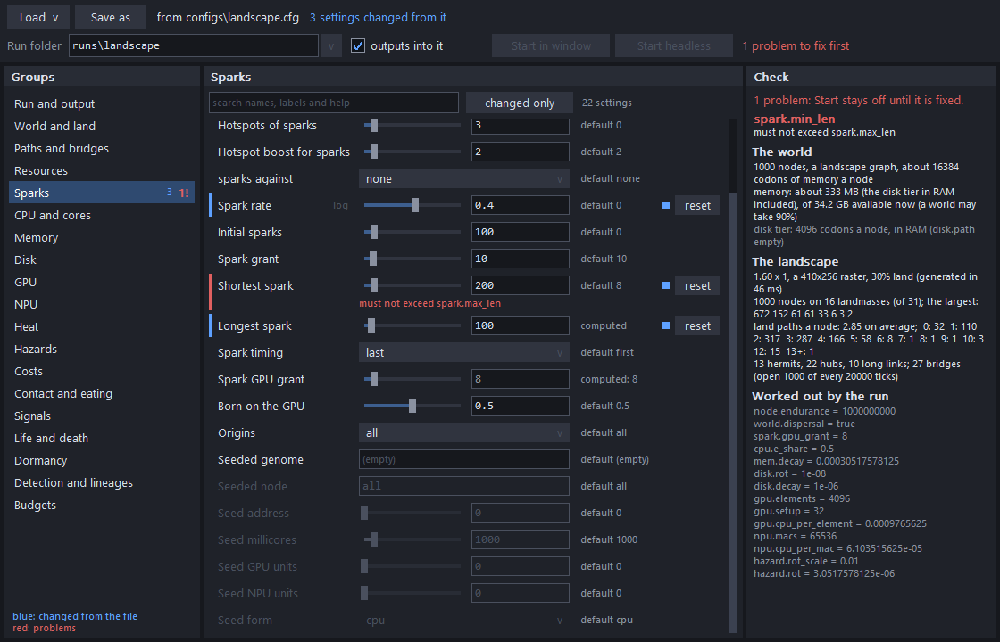
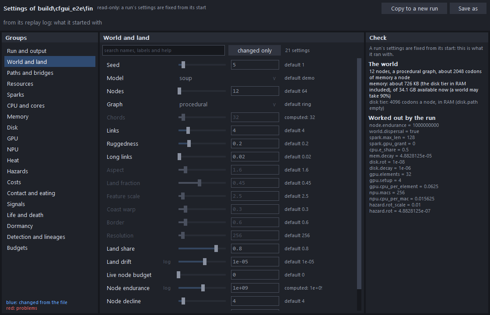

# Results: the configuration page

Steps 2 to 4 of `docs/config-plan.md` (revision 1): calls C2 (the page), C3 (before a run only), C4 (the check) and C5 (Load and Save as). Damian approved the plan and agreed to C3's recommendation: the toolbar's 7 live knobs are locked, so every run's settings are fixed from its start. Built 2026-11-07 on top of the settings registry (`docs/results/registry.md`).

## What was built

### The page (C2)

- **Where it opens:**
  - `nova view` with no config opens the page on the default preset.
  - `nova view --setup <config>` opens it on that file. `--set key=value` applies changes before it opens, and `--group NAME` picks the first group shown.
  - `--render out.png [--size WxH]` draws the page to a PNG instead of opening a window.
  - Both commands are in the usage text and in the README's start section.
- **It comes entirely from the registry** (`key_count`, `key_at`, `kKeyGroups`). No key list is written into the page, so keys added to `keys.inc` show up with no page code.
- **Layout:**
  - The groups run down the left. Each shows how many of its settings differ from the file (blue) and how many have problems (red).
  - The selected group's settings are on the right, one row each:
    - the label (a faint "log" marks a logarithmic knob);
    - the control;
    - the default;
    - a blue mark and a left bar if it differs from the loaded file;
    - a **reset** button.
  - Hovering a row shows the key's name, its help, its kind and range, its needs (and whether they're met), and the value the run works out.
  - A search box looks for every typed word in the name, the label or the help, and filters as you type (Esc clears it). A **changed only** button lists what differs from the file. Either one lists matching settings from every group, under group headings.
  - The list scrolls with the mouse wheel or a scrollbar you can drag (click the track for a page).
  - The right-hand panel shows the check (C4).
- **Controls, by kind:**
  - *switch:* a checkbox;
  - *whole number* and *number:* a slider beside a number field, held to the setting's range, logarithmic where the registry says;
  - *choice:* a drop-down;
  - *text:* a text field, used for paths too.

  Built like the viewer's widgets: immediate mode, the same dark theme (now shared in `app/theme.h`), Segoe UI and Consolas, and every size through `Canvas::px` for per-monitor DPI.
- **Rules from the registry:**
  - Hidden settings aren't shown.
  - A setting whose `needs` is off is greyed out and takes no input, but keeps its value. Needs chain, so a setting whose switch's own switch is off is greyed too.

### Before a run only (C3)

- **Start** writes the full configuration (every setting, defaults included) to the run's folder as `run.cfg`, then:
  - **Start in window** starts the run with the same code `nova view <config>` uses (`start_live`) on that `run.cfg`, and switches the window to the panels;
  - **Start headless** launches `nova run <folder>\run.cfg --stop-file <folder>\stop` (plus `--threads N` if it was given), using the same `nova.exe` in a console of its own (`CreateProcess`, `CREATE_NEW_CONSOLE`). The page then shows the run with a **Stop it** button, which creates the stop file. Esc in that console also stops it.
- **The folder** is typed into a field or picked from a drop-down of the folders under `runs\`. It defaults to `runs\<name>`: the loaded file's name, or a run's own folder name when the file is its `run.cfg`, with `-2`, `-3` and so on if that folder already holds a run. Start refuses a folder that already holds a `run.cfg`. Missing parent folders are created.
- **During a live run** the toolbar's new **Settings** button shows the page read-only, with what the run started with (its config after `Run::init`, budgets resolved), and **Back to the run**.
- **A finished run** (`nova view --run <dir>`): the Settings button shows the settings from its replay log's config lines, read-only. If the log holds knob records from before the lock, a line says how many (replay still applies them). **Copy to a new run** makes the page editable from those settings, with a fresh folder.
- **A snapshot:** continuing one shows its settings read-only. A continued snapshot keeps them.
- **Read-only page, all modes:** controls take no input. Values still read clearly, while greyed-out ones stay faint. **Save as** still works.
- **The knob lock:**
  - The toolbar's second row (the knob fields and the −/+ buttons) is gone. So are `kCmdKnob` and its handling in the sim thread. The toolbar is one row again.
  - `Run::lock_knobs()` makes `schedule_knob` refuse every new change, with the message "a run's settings are fixed from its start". `nova run`, and `nova view` for configs, `run.cfg` and snapshots, lock their run as soon as it's made.
  - `replay_verify` doesn't lock: it schedules an old log's knob records before the first tick, so those logs still replay to the same hash.
  - `World`'s knobs are unchanged, with comments that they remain only for replay.
  - The 7 settings' help no longer says "a live knob" (`keys.inc`; `docs/keys.md` regenerated).

### The check (C4)

`check_settings()` (`core/include/nova/check.h`, `core/src/check.cpp`) runs the engine's own code on the page's config text without building the world. The page runs it after every change (a slider's change counts when you let go).

1. **The reads:**
   - It reads the budgets' own settings, then calls `World::check_settings`, then the front end's reads (`read_run_keys`, passed in by the shell).
   - `World::check_settings` is `World::init` with a `check_only_` flag. It reads and checks every setting exactly as a run does: the same reads and cross-checks, `soup_params_from_config`, `detect_params_from_config`, the landscape and spread settings, and the accelerator and warp settings. Then it returns before building anything. It opens no device and creates no disk folder.
2. **Every problem, by setting:**
   - Config keeps only its first problem, so the check reads again with that setting left out (back to its default), until the reads come back clean. That collects one problem per setting, in the engine's own words, for example `spark.min_len: must not exceed spark.max_len` and `cpu.e_share: needs a timed cost table` together.
   - Each problem shows under its setting's row in red, and in the panel, where a click jumps to the setting.
   - A key that isn't a setting is a problem for the file as a whole, with a **drop unknown keys** button.
3. **Effective values:**
   - A new value hook on the registry's readers (`key_set_value_hook`, `keys.h`) records the value each read gives back. So computed defaults show what the run will actually use, for example `world.chords = 20` for 40 nodes.
   - The control shows that value, dimmed. The default column reads "computed: X", and the panel lists every computed default under **Worked out by the run**.
4. **Memory and disk:**
   - On a page that's about to start, the budgets are resolved on a copy, as `Run::init` does: `budget.memory` against the memory available now, `budget.disk` against the volume.
   - The world's footprint is shown against the machine, using the budgets' own sums: RAM at `kRamPerCodon` per codon, plus the disk tier when it's in RAM, and the disk tier's files against the free space.
   - The fit check's refusal becomes a problem by setting.
   - The device budgets (`budget.gpu`, `budget.npu`) need a calibration on the real devices, which takes a second or so. The check leaves that for the run's start, and a note says so.
5. **The landscape:**
   - For a landscape world it generates the landscape (`generate_landscape`, the same as `nova land`) and summarises it: size, raster, land share, landmasses (the largest), land paths per node (mean and histogram), hermits, hubs, long links and bridges with their schedule.
   - It's cached, and generated again only when the landscape's settings change (45 ms for `landscape.cfg`'s 1,000 nodes in Debug).
   - A landscape that can't be built is a problem at `world.nodes`.
6. **Start** stays off while any problem is open; the bar says why ("1 problem to fix first").

### Files (C5)

- **Load** opens a drop-down of `configs\*.cfg` (one click), plus "open a file by its path...", which takes any typed path.
- **Save as** offers `configs\<name>-2.cfg` (the first free name) and writes only the settings that differ from their defaults. They're grouped under `# --- Group ---` headings, each line commented with its label and default, so the file reads like today's presets. Keys that aren't settings are kept as comments.
- `nova run <config>` and `--set` work as before, with one deliberate relaxation (settled detail 9).

## Settled details

1. **The default preset** is `configs\landscape.cfg`, the README's quick start. It's looked for in the current folder, then beside `build*\bin\nova.exe`; the presets for Load are then listed from that folder. If it can't be found, the page opens with every setting at its default and says so.
2. **Reset and the default:** **reset** puts a setting back to the loaded file's value. A click on the default text takes the default. For a computed default, that leaves the setting unset, so the run works it out.
3. **Typed values:**
   - A number outside the range is held to it, and an in-range whole number keeps its exact text.
   - A value at or below an open minimum (`detect.similarity`) is refused, as is malformed text. A refused value leaves the field open with a red frame and a message in the bar.
   - Enter, or a click elsewhere, applies; Esc cancels.
   - Text can't hold `#` (the config format can't).
4. **Slider spans:**
   - A narrow range is the whole slider.
   - A very wide one (more than 20 times the default or the loaded value) runs from the minimum to 10 times that value; the number field takes the whole range.
   - A logarithmic one spans 10^-6 to 10^6 times the default (or the loaded value, when the default is 0), up to the range's maximum. Its left end is the minimum itself (0 means off).
   - Spans don't move while you drag, and they re-centre only when a value lies outside them. The value applies when you let go, even if the mouse is off the row or outside the list.
5. **`run.cfg`:**
   - Every visible setting is written, grouped, plus any hidden one the file sets.
   - Values set on the page are written as typed. Every other setting is written as the check read it, so computed defaults are pinned to the values the run would work out. The comment says which ones differ from their default and which were worked out.
   - A computed default that nothing read (its feature off) is left as a comment for the run to work out, so `run.cfg` never pins a value the check didn't see.
6. **Outputs into the folder** (a checkbox beside the folder, on by default): each output path that's on keeps its file name but goes into the run's folder, beside `run.cfg`. Then `nova view --run <folder>` browses it. Outputs that are off stay off.
7. **A run started in the window** is set up on the UI thread, as `nova view <config>` sets one up before the window opens. A big landscape with real devices can take a few seconds, during which the window doesn't repaint.
8. **Budgets and `run.cfg`:** the budgets stay as set (`budget.memory = 25%`), so they resolve again when the run starts. The run's replay log and snapshots record what they resolved to, as before.
9. **Settings that nothing reads:** `nova run` and `nova view` now accept a key the registry knows that nothing read (its feature is off), using `key_accept_known` before `Config::first_unused`. A key with no registry entry still fails as a typo. This is needed because `run.cfg` names every setting: a procedural world's `run.cfg` holds `land.aspect`, which the world never reads.
10. **The machine check** (budget resolution and the fit) runs only on an editable page. On a read-only page, a running world's own memory would count against it.

## Deviations and limits

- **No count of distinct substrates** in the landscape summary: substrates aren't built in this base (the world plan's W1, the world agent's work).
- **What the check can't see:** only settings read in `World::init` before it starts building, in the reading part. A key that other work reads later, during the build, would have no effective value or range check on the page. None does today. When merging: new reads belong before `if (check_only_) return true;`, and any new device or folder opening in `init` should respect `check_only_`.
- **Two places that must keep in step:**
  - `check.cpp` repeats the sums that `resolve_budgets`' fit check makes (a few lines). When the disk tiers change the fit check, the page's numbers need the same change.
  - The landscape cache compares `LandParams` field by field (`same_land`), so a new field must be added there.
- **No clipboard and no file dialogs.** The viewer links only `user32` and `gdi32`, and the common dialogs live in `comdlg32`. So Load lists the presets and takes a typed path, and Save as and the run folder take typed paths. Paste into text fields isn't supported either.
- **Not tested in a real window.** The machine is shared, so I didn't open one. The page was driven by made-up input in the tests, as the viewer's panels are, and rendered headless. Start in window's request handling in `view_cmd.cpp` has no automated test, but the start itself (`start_live`) is the same code the test runs through `nova view run.cfg --render`.
- **Copy to a new run** is offered for finished runs (`--run`), not for a live run in the window, even once it has stopped.
- `design.md` 6.12's live-knob paragraph now carries a short "superseded" note pointing here. The rest of `design.md` is unchanged.

## Determinism

- **Nothing in the world changed.** The check reads settings and builds nothing, the lock refuses only new changes, and the page only produces configuration files. Every pinned and gate hash is unchanged (`verify.ps1` green).
- **A run started from the page is `nova run` on its `run.cfg`.** The viewer suite writes a page's `run.cfg` for a 24-node procedural world with two settings changed, then compares:
  - a `Run` loaded from the file, at 4 threads;
  - a `Run` from the settings the page started from, at 2 threads;
  - `nova.exe run run.cfg` at 3 threads;
  - `nova.exe view run.cfg --render`, the window's own start path.

  All four give hash `84ad0567105b4385` at tick 40.
- **Old replay logs still replay.** The replay suite keeps a fixed v2 log, recorded once with three knob changes made mid-run as the old toolbar made them. It replays to every logged hash at 1 and 4 threads. Without its knob lines it diverges at the first checkpoint after the first change.

## Tests

- **Suite `viewer`** (`tests/test_setup.cpp`, run from `suite_viewer`). Each item below is checked with made-up input:
  - a checkbox toggles;
  - a needs switch greys its settings, which keep their values and take no clicks;
  - a slider drags past its end and clamps (16 for `isa.stack_depth`, 1 at the left), and its middle is about 8;
  - a logarithmic slider (`hazard.copy`) gives 0 at its left end and 1 at its right, with the middle decades below the top;
  - a drop-down picks (`world.graph`), which changes what is greyed;
  - a typed value applies; one out of range is held to it; nonsense is refused, with the field still open; a click elsewhere applies;
  - text is typed into `seed.genome`;
  - "changed only" lists exactly the changed settings, and reset removes one from the list;
  - search finds exactly the settings whose name, label or help holds every word, and typing into the search box filters;
  - computed defaults are worked out;
  - two cross-check problems at once, each under its row;
  - Start is dead while a problem is open and asks the shell to start (with the folder) once it's fixed;
  - a range problem in a loaded file, and a key that isn't a setting;
  - the world's size against the machine;
  - a landscape's summary, and one that can't be built;
  - Save then Load (text and file) gives every setting back;
  - `run.cfg` holds every effective setting, with computed defaults nothing read left as comments, and hashes as above;
  - the page renders headless in every group, editable and read-only;
  - Copy to a new run and Back to the run.
- **Suite `viewer`** (`tests/test_view.cpp`): clicks and typing where the knob row was issue nothing, and every toolbar click is a run control or Settings. A run locked as the front ends lock theirs refuses a new change, while a change scheduled before the lock still applies.
- **Suite `replay`:** the old log with knob records, as above.
- **Unchanged and still green:** the knob tests in `view`, `rules`, `soup`, `snapshot`, `dispersal`, `world` and `replay`. Their runs aren't locked, as replay's aren't. `keys` passes with the help text changed and `docs/keys.md` regenerated.

## Files touched

- New: `core/include/nova/check.h`, `core/src/check.cpp`, `app/setup.h`, `app/setup.cpp`, `app/theme.h`, `tests/test_setup.cpp`, `docs/results/configui.md`, `docs/results/configui-page.png`, `docs/results/configui-finished.png`.
- Changed:
  - `core/CMakeLists.txt` (`check.cpp`);
  - `core/include/nova/keys.h` and `core/src/keys.cpp` (the value hook, `key_accept_known`);
  - `core/src/keys.inc` (8 help strings: the 7 locked settings' and `output.replay`'s);
  - `core/include/nova/world.h` and `core/src/world.cpp` (`check_settings` and `check_only_`, the knob comments);
  - `core/include/nova/run.h` and `core/src/run.cpp` (the knob lock);
  - `app/CMakeLists.txt` (`setup.cpp`);
  - `app/main.cpp` (the lock and `key_accept_known` in `nova run`, the usage text);
  - `app/view_cmd.cpp` (the page, Start, the read-only modes, the lock);
  - `app/viewer.h` and `app/viewer.cpp` (no knob row, no `kCmdKnob`, the Settings button, the shared theme);
  - `tests/CMakeLists.txt` (`test_setup.cpp`, `NOVA_EXE`, the dependency on `nova`);
  - `tests/test_view.cpp`, `tests/test_replay.cpp`;
  - `docs/keys.md` (regenerated), `docs/design.md` (6.12 note), `README.md` (start section, layout, determinism).
